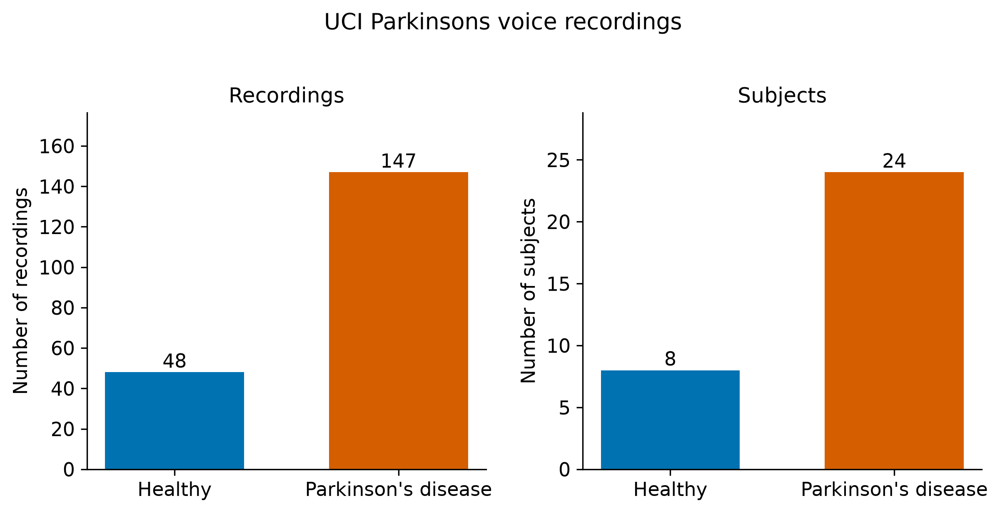
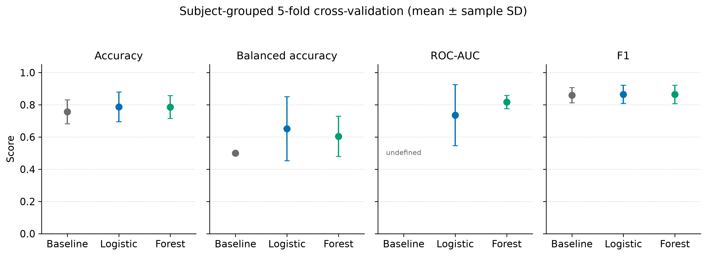
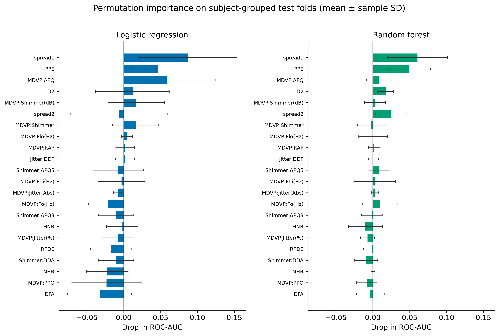

# Parkinson's Voice Biomarker ML

[](https://github.com/Ishitta-Sarkar/parkinsons-voice-biomarker-ml/actions/workflows/ci.yml)
[](LICENSE)

[](https://colab.research.google.com/github/Ishitta-Sarkar/parkinsons-voice-biomarker-ml/blob/main/notebooks/parkinsons_voice_analysis.ipynb)

Can sustained-vowel voice measurements tell people with Parkinson's disease (PD) apart from healthy controls, **when the model is tested on people it has never seen?**

A recording-level split does not answer that question. Each subject contributes six or seven phonations, so a random split of rows puts the same voice on both sides of the split. This repository scores a majority-class baseline, an L2 logistic regression, and a random forest with **subject-grouped stratified cross-validation**.

The numbers below are from one run of `python src/train.py` (Python 3.12.3, scikit-learn 1.9.1, seed 42). Tables are in `results/`, and `results/run_metadata.json` records the exact settings.

## Dataset

**UCI Parkinsons** (Little et al., 2007; Little et al., 2009): 195 sustained-phonation recordings. Each recording has 22 acoustic features (fundamental frequency, jitter, shimmer, noise-to-harmonics ratio, RPDE, DFA, spread, PPE, and related measures). The target is `status` (1 = PD, 0 = healthy).

- Source: https://archive.ics.uci.edu/dataset/174/parkinsons ([CC BY 4.0](https://creativecommons.org/licenses/by/4.0/))
- DOI: https://doi.org/10.24432/C59C74
- File: `data/raw/parkinsons.data`, byte-identical to the UCI file (SHA-256 `a36116c2deac07895b79ce97a2f99a1b3720ac4892995ff5c3b9ccb397ed2bc5`)
- The subject id is the `S##` token in `name` (`phon_R01_S01_1` → subject `S01`)

The UCI catalogue text says 31 people, 23 with PD. The `name` column in the file encodes **32 subject ids: 24 PD and 8 healthy** (147 and 48 recordings). No id carries both labels. Folds are grouped on those 32 ids. Counts, the column dictionary, and the two algebraic duplicate pairs (`Jitter:DDP = 3 × MDVP:RAP`, `Shimmer:DDA = 3 × Shimmer:APQ3`, up to rounding) are in [`data/README.md`](data/README.md).



> **Why the split is grouped by subject.** In the stratified 80/20 split of recordings used as a comparison (`random_state=42`), all 32 subjects appear in the training set and 24 of them also appear in the test set. All 39 test recordings belong to someone the model has already heard. Five-fold stratified CV on recordings has the same property on every fold. Accuracy from those splits is not an estimate for a new person.

## Methods

The three models were fixed before looking at the test folds:

1. Majority-class baseline: `DummyClassifier(strategy="most_frequent")`.
2. L2 logistic regression (`C=1`, `lbfgs`, `max_iter=5000`) with `StandardScaler` fit inside each training fold.
3. Random forest, 500 trees, `random_state=42`, remaining scikit-learn defaults.

Evaluation is `StratifiedGroupKFold` (5 folds, shuffle, `random_state=42`) with the subject id as the group. The positive class is PD (`status=1`). Metrics are accuracy, balanced accuracy (unadjusted mean of sensitivity and specificity), ROC-AUC, and F1. Each cell below is the mean ± the sample standard deviation of the five fold scores (ddof=1). ROC-AUC is the primary metric because 147 of 195 recordings are PD, so accuracy and F1 stay high for a classifier that calls almost everyone PD. The baseline ROC-AUC is undefined: its score does not vary.

Permutation importance is the drop in ROC-AUC when a column is shuffled on a grouped test fold (20 repeats, seed 42), then the mean and sample SD across the five folds. Training rows are not used for the permutation.

No hyperparameter search was run. Choosing a model or a setting on these same folds would make the reported scores optimistic.

## Results

Subject-grouped 5-fold cross-validation:

| Model | Accuracy | Balanced accuracy | ROC-AUC | F1 |
|---|---|---|---|---|
| Majority baseline | 0.756 ± 0.074 | 0.500 ± 0.000 | undefined | 0.860 ± 0.048 |
| Logistic regression | 0.787 ± 0.092 | 0.652 ± 0.199 | 0.736 ± 0.189 | 0.865 ± 0.056 |
| Random forest | 0.786 ± 0.071 | 0.604 ± 0.125 | 0.817 ± 0.041 | 0.864 ± 0.057 |



On accuracy and F1 the fitted models sit next to the baseline. The forest accuracy is 0.786 ± 0.071 against a baseline of 0.756 ± 0.074, and the fold standard deviations overlap. Balanced accuracy moves off the baseline value of 0.500 (logistic regression 0.652 ± 0.199, forest 0.604 ± 0.125), with wide fold-to-fold scatter: several test folds contain only six healthy recordings. ROC-AUC is where the forest is most stable, at 0.817 ± 0.041. The logistic regression ROC-AUC is 0.736 ± 0.189. There is ranking signal on held-out subjects. It is modest, and it is not a thresholded accuracy in the high nineties.

### What a recording-level split reports instead

The same three models on stratified 5-fold CV of recordings, which shares subjects across every fold:

| Model | Accuracy | Balanced accuracy | ROC-AUC | F1 |
|---|---|---|---|---|
| Majority baseline | 0.754 ± 0.014 | 0.500 ± 0.000 | undefined | 0.860 ± 0.009 |
| Logistic regression | 0.867 ± 0.056 | 0.795 ± 0.088 | 0.905 ± 0.047 | 0.913 ± 0.036 |
| Random forest | 0.887 ± 0.069 | 0.824 ± 0.130 | 0.958 ± 0.030 | 0.928 ± 0.043 |

A single stratified 80/20 split of recordings, same 500-tree forest and seed, gives accuracy 0.923, balanced accuracy 0.883, ROC-AUC 0.972 and F1 0.949. Rerunning that split with 100 trees (the default used by the earlier script in this repository) gives the same accuracy 0.923 and F1 0.949, and ROC-AUC 0.962. In that split every test recording belongs to a subject who is also in training. Those figures stay in `results/holdout_comparison.csv` so the inflation is visible. They are not the result of this project.

### Which features move the score

On the grouped test folds, the largest mean drops in forest ROC-AUC are `spread1` (0.061 ± 0.041) and `PPE` (0.050 ± 0.029), then `spread2` (0.025 ± 0.021) and `D2` (0.018 ± 0.011). The logistic regression shows the same two leading columns, `spread1` (0.088 ± 0.066) and `PPE` (0.046 ± 0.035), with `MDVP:APQ` in between and a standard deviation larger than the mean. Several jitter and shimmer columns are copies of each other, so a small importance on one of a duplicate pair is not a separate biological finding. The whiskers are wide relative to the bars. This is a description of this cohort.



Subject-level distributions and the correlation matrix are in `figures/subject_feature_medians.png` and `figures/feature_correlation.png`. The notebook plots them next to the cohort counts.

## Reproduce

Python 3.12 is required (the pinned NumPy release does not support older interpreters).

```bash
git clone https://github.com/Ishitta-Sarkar/parkinsons-voice-biomarker-ml.git
cd parkinsons-voice-biomarker-ml
pip install -r requirements.txt
python src/train.py          # writes results/ and figures/
pytest -q
```

`notebooks/parkinsons_voice_analysis.ipynb` calls the same functions and is stored with its outputs. The Colab badge opens that notebook; the first cell clones this repository when the data file is not already on disk.

## Repository layout

```text
data/raw/parkinsons.data          UCI file, unchanged
data/README.md                    data card, checksum, citation
notebooks/parkinsons_voice_analysis.ipynb
src/data_loader.py                loading, subject ids, cohort counts
src/train.py                      grouped CV, baseline, metrics, importance
src/visualization.py              figures
results/model_metrics.csv         subject-grouped means and sample SDs
results/fold_metrics.csv          one row per model per fold
results/record_level_cv.csv       leaked recording-level CV, for comparison
results/holdout_comparison.csv    leaked 80/20 split, for comparison
results/feature_importance.csv
results/run_metadata.json
figures/
tests/
```

## Limitations

Thirty-two subject ids, one phonation protocol, no second cohort. Grouped cross-validation stops the model from being tested on a voice it has already heard. It does not replace an external test set. Accuracy and F1 are easy to over-read because most recordings are PD. Fold standard deviations are large, especially for logistic regression. Two feature pairs are algebraic duplicates. Age, sex, severity, and medication are not in the file. Nothing here is a diagnostic tool or a screening claim.

## References

- Little MA, McSharry PE, Roberts SJ, Costello DAE, Moroz IM. Exploiting Nonlinear Recurrence and Fractal Scaling Properties for Voice Disorder Detection. *BioMedical Engineering OnLine*. 2007;6:23. https://doi.org/10.1186/1475-925X-6-23
- Little MA, McSharry PE, Hunter EJ, Spielman J, Ramig LO. Suitability of Dysphonia Measurements for Telemonitoring of Parkinson's Disease. *IEEE Transactions on Biomedical Engineering*. 2009;56(4):1015–1022. https://doi.org/10.1109/TBME.2008.2005954
- Little, M. (2007). Parkinsons [Dataset]. UCI Machine Learning Repository. https://doi.org/10.24432/C59C74

## Citation

Software citation metadata is in [`CITATION.cff`](CITATION.cff). Please cite the dataset and the two papers above as well as this repository.

## Author

Ishitta Sarkar · [ORCID 0009-0008-1028-6010](https://orcid.org/0009-0008-1028-6010)

M.Tech in Bioinformatics (in progress, expected 2028). B.Tech Biotechnology (Honours), Dr. A.P.J. Abdul Kalam Technical University, 2022–2026.

MIT License.
